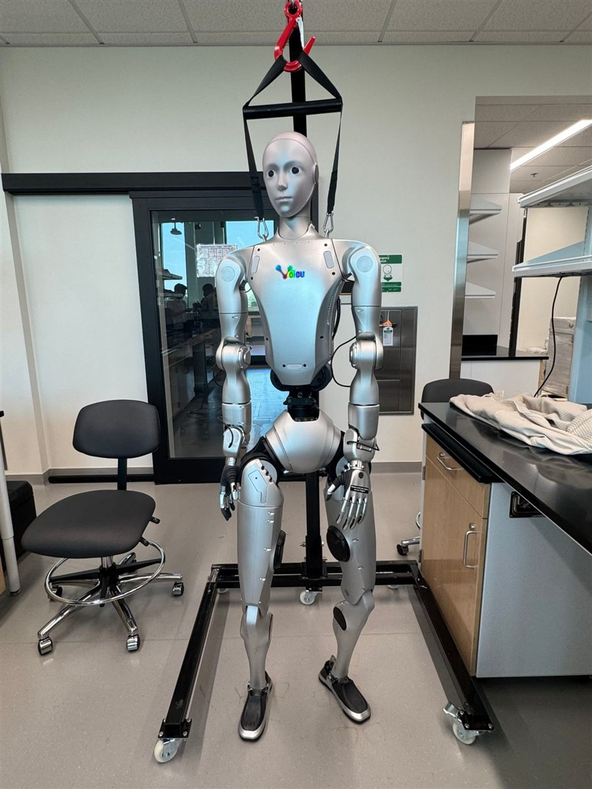

*Work in Progress*

This project focuses on developing an AI-powered laboratory assistant using the Unitree H2 humanoid robot. The goal is to enable the robot to assist with routine laboratory tasks, such as navigating between workstations, responding to voice commands, recording information, and interacting with laboratory equipment.

## System Development

- **Perception & Navigation:** Developing methods for the robot to recognize its surroundings, localize itself, and navigate between laboratory workstations.
- **Voice Interaction:** Integrating a large language model (LLM) to interpret spoken commands and support natural language interaction with the robot.
- **Manipulation:** Developing arm and hand control methods for grasping and interacting with laboratory objects and equipment.
- **Onboard AI Assistant:** Developing a separate computing system capable of operating independently of the robot, with planned features such as setting timers, recording and summarizing notes, managing reminders, and answering questions.

## Mechanical Design

Designed a custom electronics backpack for the Unitree H2 to house an NVIDIA Jetson Nano and supporting power and electrical components. The enclosure is being developed with consideration for ventilation, cable routing, component placement, and access to connections.

A separate protective cover is also being designed for the cables near the robot's neck.

## Project Gallery

*Coming soon.*

## Acknowledgements

This project is being developed in collaboration with Evan Benjamin, Edward Clarkston, and Jelan Womack under the guidance of Dr. Razvan Voicu at Kennesaw State University.
